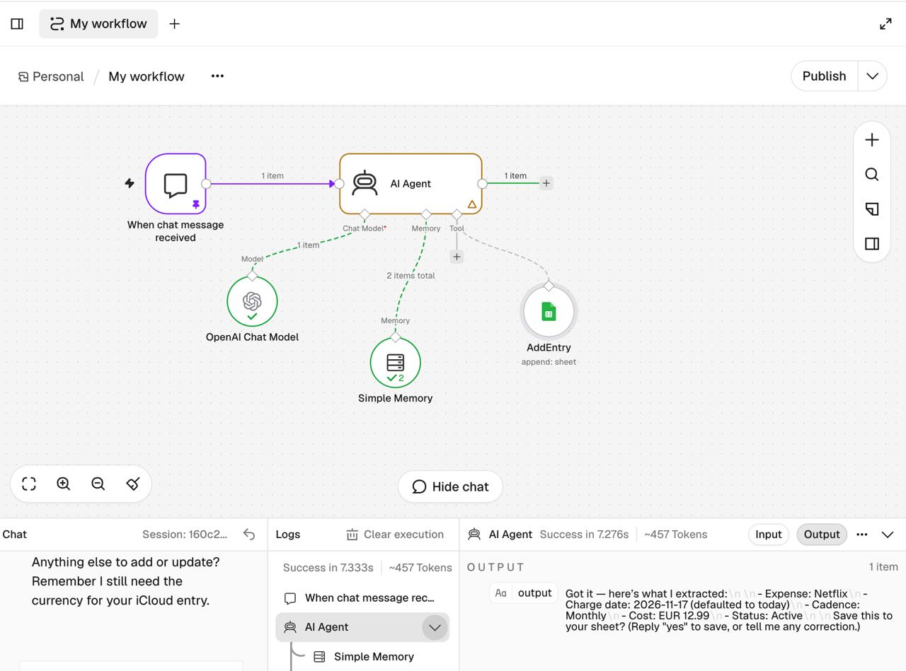
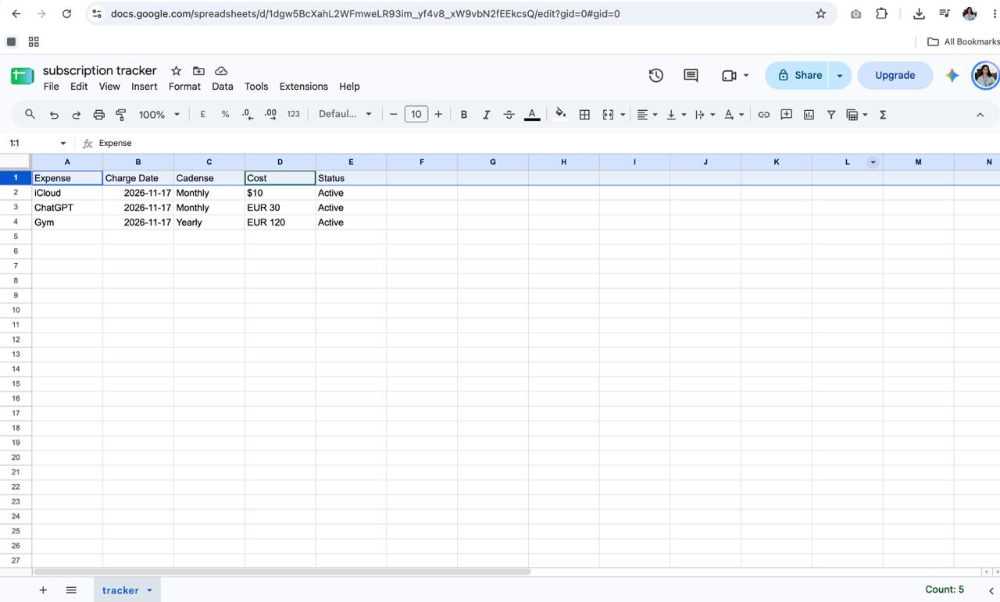

# AI-Powered Subscription Tracker

### Single-Agent AI System | n8n • OpenAI • Google Sheets

## A. Project Overview

An AI-powered subscription tracking system built with **n8n, OpenAI GPT-5 mini, Simple Memory, and Google Sheets**.

The system automates recurring expense tracking through natural-language conversations.

For example:

> "I subscribed to Netflix for €12.99 per month."

The AI Agent extracts subscription details, requests user confirmation, and automatically records the information in Google Sheets.

## B. System Architecture

This project uses a **Single-Agent Architecture**, where one central AI Agent coordinates language understanding, conversational memory, and external tool execution.

### Core Components

**1. Chat Trigger — Input**

Receives user messages and initiates the workflow.

**2. AI Agent — Orchestrator**

Coordinates information extraction, validation, confirmation, and tool execution.

**3. OpenAI Chat Model — Brain**

Uses GPT-5 mini to understand natural language and extract subscription details.

**4. Simple Memory — Context**

Maintains recent conversation history for follow-up questions and confirmations.

**5. Google Sheets (AddEntry) — Tool**

Automatically appends confirmed subscription records to Google Sheets.

## C. Workflow Process

1. **Input:** User describes a subscription.
2. **Processing:** AI extracts service name, cost, currency, billing frequency, date, and status.
3. **Validation:** Missing information is requested.
4. **Confirmation:** Agent asks the user to approve the extracted details.
5. **Execution:** `AddEntry` saves the subscription to Google Sheets.
6. **Output:** Agent confirms successful registration.

## D. Results & Demo

The workflow was successfully tested using fictional subscription records.

**[View Live Google Sheets Demo](https://docs.google.com/spreadsheets/d/1dgw5BcXahL2WFmweLR93im_yf4v8_xW9vbN2fEEkcsQ/edit?gid=0#gid=0)**

The spreadsheet stores five fields: Expense, Charge Date, Cadense, Cost, and Status.

*All subscription records are fictional and used for demonstration purposes.*

## E. Technologies Used

- **n8n:** Workflow automation
- **OpenAI GPT-5 mini:** Natural-language understanding
- **AI Agent:** Decision-making and tool orchestration
- **Simple Memory:** Conversational context
- **Google Sheets API:** Structured data storage
- **JSON:** Workflow configuration

## F. Key Outcomes

- Developed a functional single-agent AI workflow.
- Integrated an LLM with memory and external tool calling.
- Automated natural-language subscription data extraction.
- Implemented user confirmation before saving records.
- Successfully tested Google Sheets integration.

## G. Limitations & Future Improvements

The current prototype supports adding new subscriptions but does not yet support editing existing records, automatic renewal reminders, or expense analytics.

Future improvements include duplicate detection, subscription updates, and spending dashboards.

## H. How to Use

1. Import `My workflow (1).json` into n8n.
2. Configure OpenAI and Google Sheets connections.
3. Select the destination spreadsheet.
4. Enter subscription details through chat.
5. Confirm the information to save the record.

---

Project Type: Single-Agent AI System  
Status: Functional Prototype  
Focus:AI Agents • Workflow Automation • LLM Integration • Tool Calling

